# INFOMAN1 - Week 10 Lab Answers

Name: Jade Roland Eduard C Pinon
Student ID: 2511036
GitHub repo: <https://github.com/arcticWulf123/infoman1>
Date submitted:

## Task 1 - Safe INSERT

**Approach / explanation:**
I used the explicit column form, `INSERT INTO products (column list) VALUES (...)`, instead of a bare `INSERT INTO products VALUES (...)`. Naming the columns ties each value to a column by name, so the statement survives reordering or adding columns later, and any column I left out, such as an auto-increment `product_id`, is filled in by the database.

**Code / query used (if applicable):**

```sql
INSERT INTO products(product_name, sku, price, stock_quantity, status) VALUES ("Scientific Calculator", "CMP-001", 120.00, 50,"Active")
INSERT INTO products(product_name, sku, price, stock_quantity, status) VALUES ("Compass", "CMP-001", 120.00, 50,"Active")
```

**Evidence (screenshot filename, output, or file reference in this folder):**


**Reflection question:**
Listing the columns explicitly matches values to columns by name rather than by position. A bare `INSERT INTO products VALUES (...)` depends on the current column order and count, so adding or reordering a column later writes values into the wrong columns or fails on a count mismatch. Omitted columns take, in order: the column `DEFAULT` if defined; the next `AUTO_INCREMENT` value; `NULL` if the column is nullable; otherwise the insert fails because the column is `NOT NULL` with no default. Skipping an auto-increment `product_id` is therefore fine, but skipping a `NOT NULL` column like `sku` errors.

## Task 2 - UPDATE & DELETE Without Collateral Damage

**Approach / explanation:**
I scoped both statements with `WHERE` on the primary key, `product_id`, so each touched exactly one row. I previewed the target with a `SELECT` using the same `WHERE` before running them, then re-ran it afterwards to confirm the result. I used `product_id` instead of `product_name` because names can repeat or change, while the key cannot.

**Code / query used (if applicable):**

```sql
UPDATE products SET price = 875 WHERE product_id = 6;
DELETE FROM products WHERE product_id = 5;
```

**Evidence (screenshot filename, output, or file reference in this folder):**
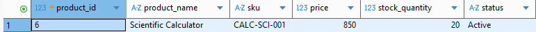

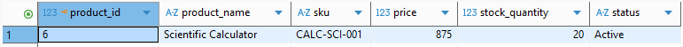


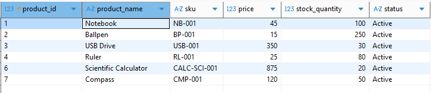

**Reflection question:**
Without `WHERE`, the `UPDATE` would rewrite that column on every row and the `DELETE` would empty the table, and autocommit makes that irreversible. A name is unsafe because it can repeat or be edited, so `WHERE product_name = 'Compass'` might match zero, one, or many rows. The primary key `product_id` is unique and permanent, so the same `WHERE` always matches exactly one row. Run a `SELECT` with the same `WHERE` first, and only proceed if it returns one row.

## Task 3 - Self Join & Cross Join

**Approach / explanation:**
_[Write 2–4 sentences describing how you solved this task.]_

**Code / query used (if applicable):**

```sql

SELECT a.employee_name AS employee_name, b.employee_name AS manager_name FROM employees AS a LEFT JOIN employees b ON a.manager_id = b.employee_id;
SELECT colors.color_name, sizes.size_name FROM colors CROSS JOIN sizes;
```

**Evidence (screenshot filename, output, or file reference in this folder):**
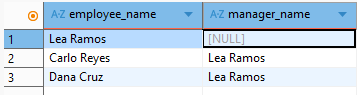

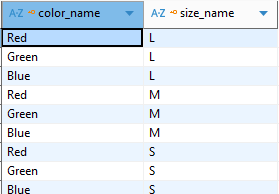

**Reflection question:**
_[Why does the self join need two aliases and a LEFT JOIN, and when is a CROSS JOIN the deliberate choice rather than a missing ON?]_

## Task 4 - Constraints & Table Evolution

**Approach / explanation:**
Each rule was added with `ALTER TABLE`, then tested with an insert that should break it. I made `product_name` NOT NULL and tried a NULL name, made `sku` UNIQUE and inserted a duplicate, and added `CHECK (price > 0)` then inserted a negative price. Each bad insert failed, which showed the constraint was enforcing the rule.

**Code / query used (if applicable):**

```sql
ALTER TABLE employees ADD contact_number VARCHAR(20)
alter table products modify product_name varchar(100) not null;
insert into products (product_name, sku, price, stock_quantity , status) values ("Smartwatch", "SW-773", 500, 10, "Active")
insert into products (product_name, sku , price, stock_quantity , status) values (null, "CSR-334", 10, 10, "Active")
alter table products modify sku varchar(30) UNIQUE
insert into products (product_name, sku, price, stock_quantity , status) values ("Monitor", "MR-899", 300, 40, "Active")
insert into products (product_name, sku, price, stock_quantity , status) values ("Camera", "MR-899", 100, 5, "Active")
ALTER TABLE products ADD CONSTRAINT check_positive_price CHECK (price > 0);
insert into products (product_name, sku, price, stock_quantity , status) values ("Smartglasses", "SG-645", 3700, 8, "Active")
insert into products (product_name, sku, price, stock_quantity , status) values ("Drone", "DR-142", -20, 2, "Active")
```

**Evidence (screenshot filename, output, or file reference in this folder):**
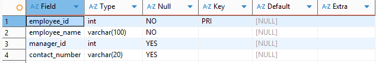

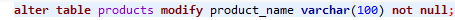

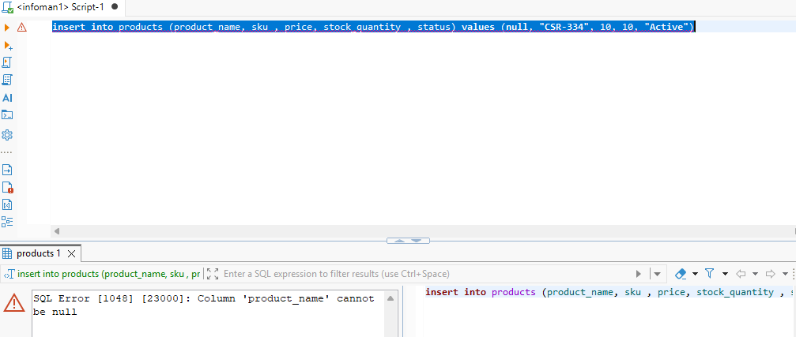

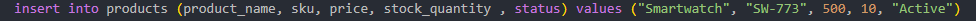

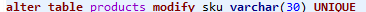

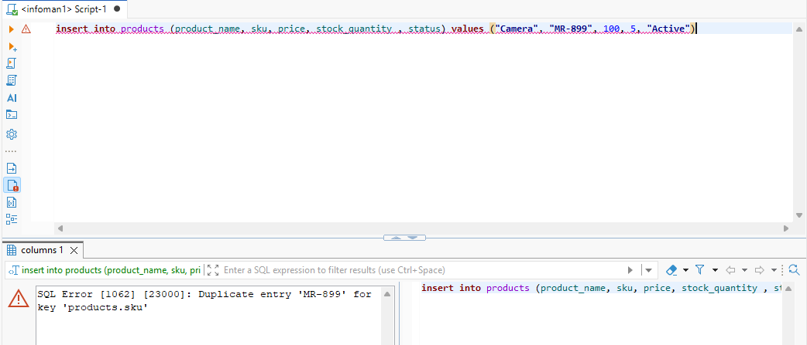

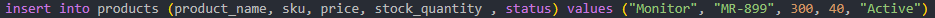

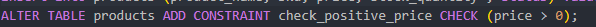

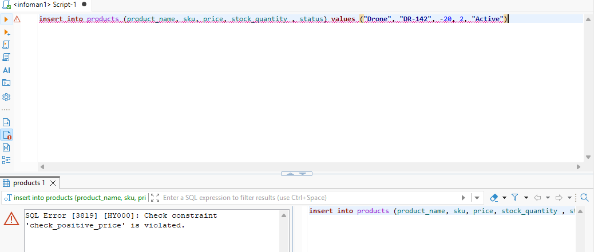


**Reflection question:**
A constraint only applies when a row is written. It blocks new bad data but does not repair rows that are already wrong, so old rows stay as they are.

Before adding NOT NULL you must fill in any existing NULLs first, for example `UPDATE products SET product_name = 'Unknown' WHERE product_name IS NULL;`. If NULLs remain, MySQL rejects the ALTER in strict mode, or quietly turns them into empty strings otherwise, which hides the bad data. UNIQUE and CHECK work the same way: existing rows must already pass, or adding the constraint fails.

## Task 5 - Reflection

**Approach / explanation:**
This task is a written reflection, so I answered it in prose instead of SQL. I compared validation in the application form with validation in the database, using the Task 4 inserts as examples of what each layer catches.

**Code / query used (if applicable):**

```sql
-- paste your SQL (or Java/JDBC, for Week 13+) here
```

**Evidence (screenshot filename, output, or file reference in this folder):**
The reflection answer above, about 160 words.

**Reflection question:**
I would trust the application form for rules about user experience: required fields, clear error messages, formatting hints, and anything that depends on who is logged in. The form can explain a mistake straight away, before the user submits, which a database error cannot do well.

I would trust the database for rules that must always hold, no matter which program writes the data. Uniqueness, non-null values, and value ranges belong there, because the database is the last gate before data is stored. A form can be bypassed by another app, a script, or someone running SQL by hand. A constraint cannot.

The symptom that the wrong layer was trusted is bad data sitting in the table even though the form seemed to prevent it. If a duplicate SKU or a negative price shows up in the database, the rule lived only in the application, so any path that skipped the form let it through.

## Self-Check

- [ ] All tasks committed with individual, meaningful commit messages
- [ ] All files placed inside `week10/`
- [ ] This file completed and renamed `answers.md`
- [ ] Repository link pasted into Moodle (no files uploaded)
