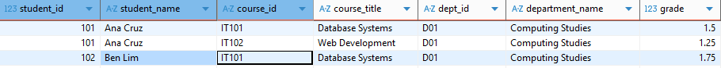
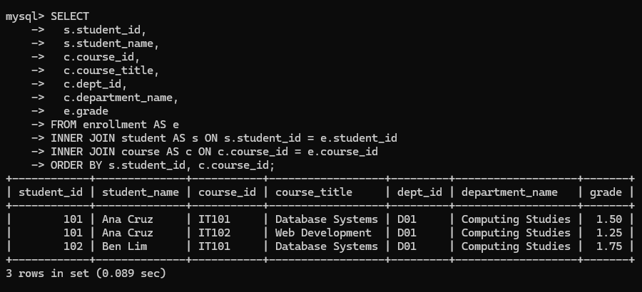
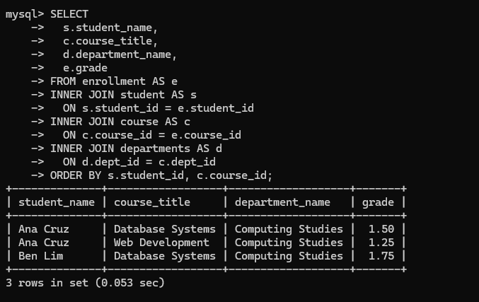

# INFOMAN1 — Week 11 Lab Answers

Name: Jade Roland Eduard C Pinon
Student ID: 2511036
GitHub repo: <https://github.com/arcticWulf123/infoman1>
Date submitted: 11/11/2026

## Task 1 — Diagnose the Anomalies

**Approach / explanation:**
I ran three `SELECT` queries on `student_enrollment`: one for `dept_id = 'D01'`, one for the missing course `IT103`, and one for `IT102`. `D01` showed `Computing Studies` repeated on every row, `IT103` returned nothing because a course needs a student, and `IT102` showed Ana's row listing two courses in one cell. This showed that all the facts are stored in one table, which causes the anomalies.

**Code / query used (if applicable):**

```sql
SELECT * FROM student_enrollment WHERE dept_id = 'D01';
SELECT * FROM student_enrollment WHERE course_id = 'IT103';
SELECT * FROM student_enrollment WHERE course_id = 'IT102';
```

**Evidence (screenshot filename, output, or file reference in this folder):**
_[e.g. `task1_output.png`, or paste console/query output here.]_

**Reflection question:**
The deletion anomaly surprised me most: deleting Ana's `IT102` row would also delete the only record of that course. All three anomalies come from one structural fact — student, course, department, and enrollment facts are all crammed into one table, so facts repeat and cannot be added, changed, or deleted independently.

## Task 2 — Reach First Normal Form

**Approach / explanation:**
I altered the existing `student_enrollment` table by dropping the multi-valued `enrolled_courses` column, since each course already had its own row through `course_id`. I then added a composite primary key on `(student_id, course_id)` so each student-course pair is unique and both key columns are required. The `SELECT` output now shows one course per row with no comma-separated values.

**Code / query used (if applicable):**

```sql
alter table student_enrollment drop column enrolled_courses;
ALTER TABLE student_enrollment ADD PRIMARY KEY (student_id, course_id);
SELECT * FROM student_enrollment ORDER BY student_id, course_id;
```

**Evidence (screenshot filename, output, or file reference in this folder):**
`task2_1nf.png`



**Reflection question:**
Splitting the list fixes the multi-valued cell, but `student_name` still repeats because a student’s name depends only on `student_id`, not on the course. That is a partial dependency, so 2NF removes it by moving student details into their own table.

## Task 3 — Reach Second Normal Form

**Approach / explanation:**
I split `student_enrollment` into three tables: `student` for student details, `course` for course details, and `enrollment` for the student-course pairs and grades. I used `student_id` and `course_id` as the primary keys for their tables, made that pair the primary key of `enrollment`, and added foreign keys to connect them. I then joined the three tables with `INNER JOIN` to confirm the original rows could still be reconstructed.

**Code / query used (if applicable):**

```sql
CREATE TABLE student (
  student_id   INT PRIMARY KEY,
  student_name VARCHAR(100) NOT NULL
);
CREATE TABLE course (
  course_id       VARCHAR(10) PRIMARY KEY,
  course_title    VARCHAR(100) NOT NULL,
  dept_id         VARCHAR(10) NOT NULL,
  department_name VARCHAR(100) NOT NULL
);
CREATE TABLE enrollment (
  student_id INT NOT NULL,
  course_id  VARCHAR(10) NOT NULL,
  grade      DECIMAL(4,2),
  PRIMARY KEY (student_id, course_id),
  FOREIGN KEY (student_id) REFERENCES student(student_id),
  FOREIGN KEY (course_id) REFERENCES course(course_id)
);


INSERT INTO student (student_id, student_name)
SELECT DISTINCT student_id, student_name
FROM student_enrollment;

INSERT INTO course (course_id, course_title, dept_id, department_name)
SELECT DISTINCT course_id, course_title, dept_id, department_name
FROM student_enrollment;

INSERT INTO enrollment (student_id, course_id, grade)
SELECT student_id, course_id, grade
FROM student_enrollment;

SELECT
  s.student_id,
  s.student_name,
  c.course_id,
  c.course_title,
  c.dept_id,
  c.department_name,
  e.grade
FROM enrollment AS e
INNER JOIN student AS s ON s.student_id = e.student_id
INNER JOIN course AS c ON c.course_id = e.course_id
ORDER BY s.student_id, c.course_id;
```

**Evidence (screenshot filename, output, or file reference in this folder):**
`task3_2nf.png`



**Reflection question:**
`student_name` is the same for every row with the same `student_id` and does not change when `course_id` changes, so it depends on only part of the composite key. `grade` changes when either the student or the course changes, so it depends on the whole `(student_id, course_id)` key. That is why `student_name` moves to `student`, while `grade` stays in `enrollment`.

## Task 4 — Reach Third Normal Form

**Approach / explanation:**
I created a `departments` table for `dept_id` and `department_name`, then copied the distinct department values from `course`. I linked `course.dept_id` to `departments.dept_id` with a foreign key and dropped `department_name` from `course`, leaving `course(course_id, course_title, dept_id)`. I then used a four-table `INNER JOIN` to confirm the student, course, department, and grade data still matched the original rows.

**Code / query used (if applicable):**

```sql
CREATE TABLE departments (dept_id VARCHAR(10) PRIMARY KEY,department_name VARCHAR(100) NOT NULL);
INSERT INTO departments (dept_id, department_name) SELECT DISTINCT dept_id, department_name FROM course;
ALTER TABLE course ADD CONSTRAINT fk_course_department FOREIGN KEY (dept_id) REFERENCES departments(dept_id);
ALTER TABLE course DROP COLUMN department_name;
```

**Evidence (screenshot filename, output, or file reference in this folder):**
`task4_3nf.png`



**Reflection question:**
`department_name` is indirectly dependent because `course_id` determines `dept_id`, and `dept_id` determines `department_name`, so the dependency is `course_id -> dept_id -> department_name`. The four-table join proves nothing was lost because it returns the same three student-course rows with the same grades, while reading the department name from the new `departments` table.

## Task 5 — Reflection

**Approach / explanation:**
_[Write 2–4 sentences describing how you solved this task.]_

**Code / query used (if applicable):**

```sql
-- paste your SQL (or Java/JDBC, for Week 13+) here
```

**Evidence (screenshot filename, output, or file reference in this folder):**
_[e.g. `task5_reflection.txt`, or paste your 150–200 word reflection here.]_

**Reflection question:**
I would keep deliberate repetition in read-heavy reports or historical records, such as storing `department_name` on a report table or a product's price on an old invoice, to avoid extra joins or preserve the value at that time. The trade-off is that every copy must be updated together. A split dropped a key when joining the tables back produces duplicate rows and a larger row count than the original, because the missing key turns a one-to-many relationship into a many-to-many match.

## Self-Check

- [ ] All tasks committed with individual, meaningful commit messages
- [ ] All files placed inside `week11/`
- [ ] This file completed and renamed `answers.md`
- [ ] Repository link pasted into Moodle (no files uploaded)
