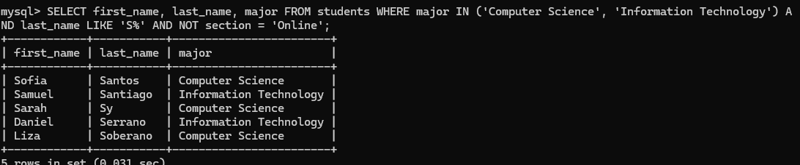
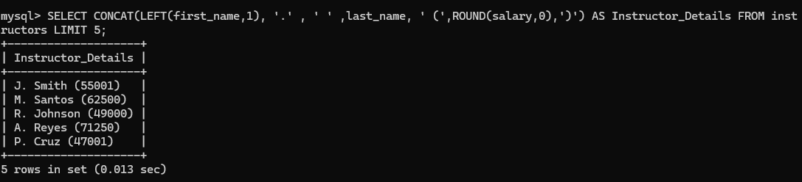
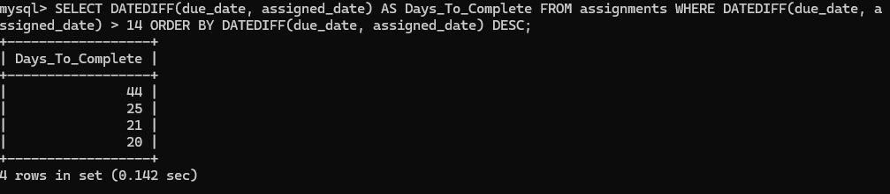

# INFOMAN1 — Week 7 Lab Answers

## Task 1 — Complex Student Roster

**Approach / explanation:**
I approached the problem by initially describing the student table so I can ensure my queries are correct, and then i used the SELECT command to get the first name, last name and the major of every student where they major in either computer science and information technology and used the AND command to have another query that filters it even further by searching those students who have last names that start with the letter S, and finally used another AND and a NOT to look for those who are not in the online section.

**Code / query used (if applicable):**

```sql
SELECT first_name, last_name, major FROM students WHERE major IN ('Computer Science', 'Information Technology') AND last_name LIKE 'S%' AND NOT section = 'Online';
```

**Evidence (screenshot filename, output, or file reference in this folder):**


**Reflection question:**
Why is it often better to use the `IN` operator rather than chaining multiple `OR` conditions when filtering by a specific list of values?
It is often much better to use the IN operator as it is less likely to cause problems with querying, forgetting to put parentheses and cause searches to display incorrect results, IN is less verbose and only requires you to put values inside the parentheses and separated by a comma for multiple values.

---

## Task 2 — Formatting Employee Data

**Approach / explanation:**
I solved the task by using the CONCAT, LEFT, ROUND AS and LIMIT commands in order to return the appropriate result of a table named Instructor Details that displays the initials of the instructor along with their surname and their salaries rounded to the nearest whole number.

**Code / query used (if applicable):**

```sql
SELECT CONCAT(LEFT(first_name,1), '.' , ' ' ,last_name, ' (',ROUND(salary,0),')') AS Instructor_Details FROM instructors LIMIT 5;
```

**Evidence (screenshot filename, output, or file reference in this folder):**


**Reflection question:**
How do string functions like `CONCAT` affect the performance of a query compared to retrieving raw columns and formatting them in the application layer (e.g., in Java or Python)?
Formatting with `CONCAT` uses the database CPU for every row, so the DB does extra work just for display. For small results like `LIMIT 5` this is fine and keeps the query reusable, but for thousands of rows it is often faster to `SELECT first_name, last_name, salary` raw and format in Java/Python, because app servers scale out more easily than the database and the DB stays free to do filtering and joins.

---

## Task 3 — Project Deadline Analysis

**Approach / explanation:**
I used the DATEDIFF function in order to calculate the days before the assignments are due and used the AS to put them inside a column named Days_To_Complete. I filtered the search even further by using the greater than operator and ORDER BY DESC to get descending order results.

**Code / query used (if applicable):**

```sql
SELECT DATEDIFF(due_date, assigned_date) AS Days_To_Complete FROM assignments WHERE DATEDIFF(due_date, assigned_date) > 14 ORDER BY DATEDIFF(due_date, assigned_date) DESC;
```

**Evidence (screenshot filename, output, or file reference in this folder):**


**Reflection question:**
Why is column aliasing particularly important when using mathematical or date functions in the `SELECT` clause?
Without an alias, MySQL would name the column something like `DATEDIFF(due_date, assigned_date)`, which is hard to read and hard to use in Java result code like `rs.getInt("DATEDIFF...")`. Using `AS Days_To_Complete` gives it a clean, stable name, so I can `ORDER BY Days_To_Complete DESC` and easily display or reference it in the app.

---

## Task 4 — Comprehensive Data Audit

**Approach / explanation:**
I used a combination of parentheses and the logical operator AND in order to make a successful query of retreiving the data that passes through the multiple conditions denoted in the task.

**Code / query used (if applicable):**

```sql
SELECT course_code, course_name, credits FROM courses WHERE (course_description IS NULL OR credits BETWEEN 4 AND 6) AND course_code LIKE '%\ADV%' ORDER BY course_name ASC;
```

**Evidence (screenshot filename, output, or file reference in this folder):**


**Reflection question:**
Explain how MySQL evaluates the expression `A OR B AND C`. How did you use parentheses (if you did) to ensure your query filtered the exact data requested in the instructions?
MySQL evaluates expressions by resolving the AND operators first and then the OR operation. I used the parentheses to get the courses where their descriptions are null or their credits are between 4 and 6 inclusive and their course code contains ADV anywhere, then have it listed in ascending order of A - Z.

---

## Self-Check

- [ ] All tasks committed with individual, meaningful commit messages
- [ ] All files placed inside `week07/`
- [ ] This file completed and renamed `answers.md`
- [ ] Repository link pasted into Moodle (no files uploaded)
