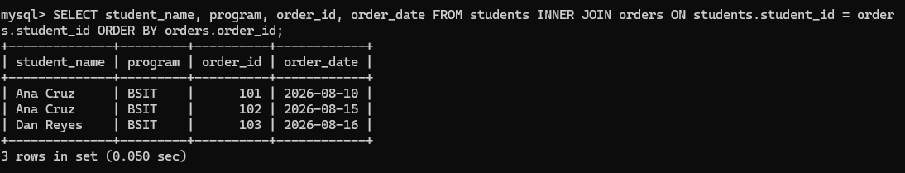
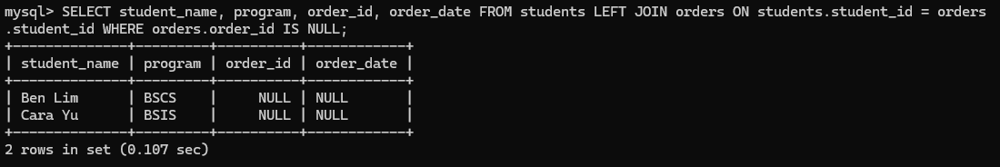
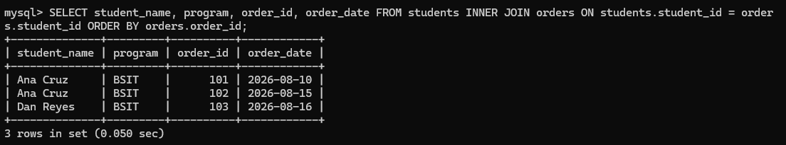
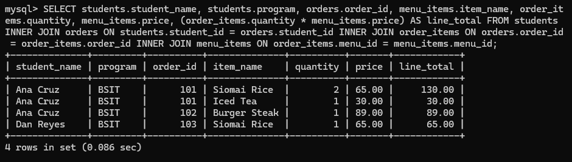
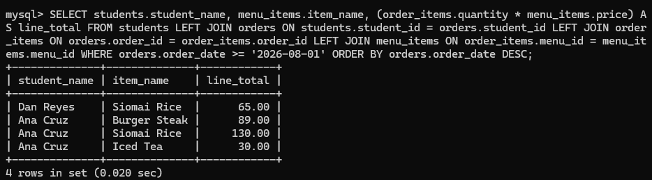
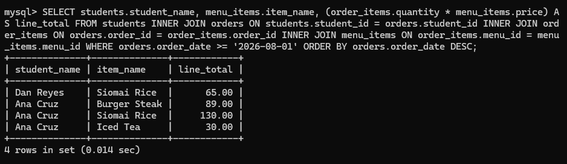

# INFOMAN1 — Week 9 Lab Answers

Name: Jade Roland Eduard C Pinon
Student ID: 2511036
GitHub repo: <https://github.com/arcticWulf123/infoman1>
Date submitted:

## Task 1 — INNER JOIN Basics

**Approach / explanation:**
I solved this by joining the students and orders tables on the column they share, student_id. I used INNER JOIN so a row only shows up when an order actually matches a student, then selected the student's name, program, order ID and order date. Finally I added ORDER BY orders.order_id so the report comes out sorted by order number instead of in whatever order the database returns it.

**Code / query used (if applicable):**

```sql
SELECT student_name, program, order_id, order_date FROM students INNER JOIN orders ON students.student_id = orders.student_id ORDER BY orders.order_id;
```

**Evidence (screenshot filename, output, or file reference in this folder):**


**Reflection question:**
_[Why does an INNER JOIN hide students who never ordered, and when is that exactly the behavior a sales report wants?]_
An INNER JOIN only keeps rows where the ON condition matches in both tables. A student who never ordered has no row in orders to pair with, so there is nothing to display and the student silently disappears from the result. That is exactly what a sales report wants, because the report is counting orders, not students — a non-buyer contributes no sale, and if you kept them you would get rows with blank order columns that mess up counts and averages. When you do need a full roster including non-buyers, that is the signal to switch to a LEFT JOIN and look for the missing ones with WHERE orders.order_id IS NULL.

## Task 2 — Finding Missing Relationships

**Approach / explanation:**
I solved this by flipping the join direction: instead of an INNER JOIN, I used a LEFT JOIN so every student is kept even when they have no matching order. Because an unmatched student has no order to pair with, the order columns come back as NULL, so I filtered on WHERE orders.order_id IS NULL to get exactly the students who never ordered. I also re-ran the INNER JOIN version beside it so I could compare the two result sets and see which students were missing.

**Code / query used (if applicable):**

```sql
SELECT student_name, program, order_id, order_date FROM students LEFT JOIN orders ON students.student_id = orders.student_id WHERE orders.order_id IS NULL;

SELECT student_name, program, order_id, order_date FROM students INNER JOIN orders ON students.student_id = orders.student_id ORDER BY orders.order_id;
```

**Evidence (screenshot filename, output, or file reference in this folder):**




**Reflection question:**
_[What does NULL mean in the unmatched columns of a LEFT JOIN, and why must you test it with IS NULL instead of equals?]_
A NULL in the unmatched columns means "there is no row on the right side to show here." The student exists, but they have no order, so the database has nothing to put in order_id or order_date and leaves those columns empty. That is absence of a value, not a value like 0 or an empty string. You have to test it with IS NULL because NULL is not equal to anything, not even another NULL: `WHERE orders.order_id = NULL` evaluates to UNKNOWN, and WHERE treats UNKNOWN as false, so it would return zero rows instead of the students who never ordered.

## Task 3 — Four-Table Canteen Report

**Approach / explanation:**
I built this report by adding the tables one at a time, starting from students and chaining a JOIN onto whatever table I had just added. Each JOIN got its own ON condition linking the new table to the previous one: students to orders on student_id, orders to order_items on order_id, and order_items to menu_items on menu_id. I then calculated line_total as quantity times price so each row shows what that item cost on that particular order.

**Code / query used (if applicable):**

```sql
SELECT students.student_name, students.program, orders.order_id, menu_items.item_name, order_items.quantity, menu_items.price, (order_items.quantity * menu_items.price) AS line_total FROM students INNER JOIN orders ON students.student_id = orders.student_id INNER JOIN order_items ON orders.order_id = order_items.order_id INNER JOIN menu_items ON order_items.menu_id = menu_items.menu_id;
```

**Evidence (screenshot filename, output, or file reference in this folder):**


**Reflection question:**
_[Why does each JOIN in a multi-table chain need its own ON condition, and what goes wrong when two joins share one?]_
Every JOIN pulls in one more table, and its ON tells the database which column connects that new table to the result built so far. Four tables means three joins, so three ON conditions are needed. If two joins share a single ON, the third table gets matched using the wrong relationship, so you end up pairing rows that do not actually belong together. The symptom is a row count that multiplies instead of staying close to the number of order items, which also inflates totals like SUM(quantity * price).

## Task 4 — Aliases, Filters, and the Silent Inner Join

**Approach / explanation:**
I wrote the same report twice so I could see what the WHERE clause does to a LEFT JOIN. The first query used INNER JOIN and filtered with WHERE orders.order_date >= '2026-08-01', keeping only orders from August onward. The second query swapped all three joins to LEFT JOIN but left the WHERE clause untouched, and the result still only showed students who had a matching order. That comparison is the point of the task: the filter runs after the join, so it quietly turns the LEFT JOIN back into an INNER JOIN.

**Code / query used (if applicable):**

```sql
SELECT students.student_name, menu_items.item_name, (order_items.quantity * menu_items.price) AS line_total FROM students INNER JOIN orders ON students.student_id = orders.student_id INNER JOIN order_items ON orders.order_id = order_items.order_id INNER JOIN menu_items ON order_items.menu_id = menu_items.menu_id WHERE orders.order_date >= '2026-08-01' ORDER BY orders.order_date DESC;

SELECT students.student_name, menu_items.item_name, (order_items.quantity * menu_items.price) AS line_total FROM students LEFT JOIN orders ON students.student_id = orders.student_id LEFT JOIN order_items ON orders.order_id = order_items.order_id LEFT JOIN menu_items ON order_items.menu_id = menu_items.menu_id WHERE orders.order_date >= '2026-08-01' ORDER BY orders.order_date DESC;
```

**Evidence (screenshot filename, output, or file reference in this folder):**




**Reflection question:**
_[Why does adding WHERE on the right-side table remove the NULL rows a LEFT JOIN just preserved, and where should that rule live instead?]_
WHERE is checked after the join is built, once for each joined row. For a student with no order, the right-side columns are NULL, so `orders.order_date >= '2026-08-01'` comes out as UNKNOWN rather than true, and the row is thrown away — the LEFT JOIN ends up behaving exactly like an INNER JOIN. The filter belongs in the ON clause instead, as an extra AND condition: `LEFT JOIN orders ON students.student_id = orders.student_id AND orders.order_date >= '2026-08-01'`. That way the join only uses matching orders, but the student is still kept with NULL order columns when nothing matches.

## Task 5 — Reflection

**Approach / explanation:**
This task was a written reflection rather than a query, so I compared the two join types I had already used in Tasks 1 to 4 and decided which one fits which report. The question I used to choose was "what is this report counting?" — students or sales. The full 150-200 word reflection is written under the reflection question below.

**Code / query used (if applicable):**

```sql
-- No query needed for this task; the answer is the written reflection below.
```

**Evidence (screenshot filename, output, or file reference in this folder):**
The 150-200 word reflection is written under **Reflection question** below — no screenshot required for this task.

**Reflection question:**
_[Which join would you choose for an "all students including non-buyers" roster versus a "completed sales only" report, and what single symptom would tell you that you picked the wrong one?]_
For an "all students including non-buyers" roster I would use a LEFT JOIN from students to orders, because the roster is about people, not purchases, so every student has to appear even if they never bought anything. For a "completed sales only" report I would use an INNER JOIN, because the unit being reported is the sale, and a student with no order has nothing to add to revenue or item counts. The single symptom that tells me I picked the wrong join is a roster that does not add up: students I know exist are missing from the result, which means an INNER JOIN dropped them, or rows show up with NULLs in every order column, which means a LEFT JOIN let non-buyers into a list that should only contain sales. Comparing the result row count to `SELECT COUNT(*) FROM students` is the quickest check, since the numbers should match for a roster and should be lower for a completed-sales report.

## Self-Check

- [ ] All tasks committed with individual, meaningful commit messages
- [ ] All files placed inside `week9/`
- [ ] This file completed and renamed `answers.md`
- [ ] Repository link pasted into Moodle (no files uploaded)
